# 4. 분산 메시지 큐

---

## 0. 들어가며: 메시지 큐를 쓰는 이유

- **결합도 완화(Decoupling)**: 컴포넌트 사이의 강한 결합을 없애 각자 독립적으로 갱신할 수 있다.
- **규모 확장성 개선**: 생산자와 소비자를 트래픽에 따라 각각 독립적으로 늘리거나 줄일 수 있다.
- **가용성 개선**: 일부 컴포넌트가 장애를 일으켜도 다른 컴포넌트는 큐와 계속 상호작용할 수 있다.
- **성능 개선**: 비동기 통신이 쉬워진다. 생산자는 응답을 기다리지 않고 메시지를 넣고, 소비자는 처리할 수 있을 때 가져간다.

### 메시지 큐 vs 이벤트 스트리밍 플랫폼

| 구분 | 대표 제품 | 특징 |
|---|---|---|
| 전통적 메시지 큐 | RabbitMQ, RocketMQ, ActiveMQ, ZeroMQ | 메시지를 소비하면 큐에서 사라진다. 보관 기간이 짧고 순서 보장이 약하다 |
| 이벤트 스트리밍 플랫폼 | Apache Kafka, Apache Pulsar | 메시지를 장기 보관하고 같은 메시지를 반복 소비할 수 있다. 파티션 안에서 순서를 보장한다 |

- 두 영역의 경계는 점점 흐려지는 중이다. RabbitMQ는 선택적 스트림 기능을 추가했고, Pulsar는 메시지 큐처럼도 쓸 수 있다.
- 이 장은 **데이터 장기 보관과 반복 소비 같은 이벤트 스트리밍 기능까지 갖춘 분산 메시지 큐**를 설계한다.

**핵심:** 이 장의 설계 대상은 Kafka에 가까운 시스템이다.

---

## 1단계: 문제 이해 및 설계 범위 확정

### 기능 요구사항

- 생산자는 메시지를 큐에 보내고, 소비자는 큐에서 메시지를 가져간다.
- 메시지는 반복 소비할 수도 있고, 한 번만 소비하게 할 수도 있다.
- 오래된 데이터는 삭제할 수 있다(예: 2주 보관).
- 메시지 크기는 KB 수준이다.
- 메시지는 생산된 순서대로 소비자에게 전달되어야 한다.
- 전달 방식(최대 한 번 / 최소 한 번 / 정확히 한 번)을 설정으로 고를 수 있어야 한다.

### 비기능 요구사항

- 높은 대역폭과 낮은 응답 지연 중 무엇을 우선할지 설정으로 고를 수 있다. (대역폭의 개념과 중요성은 [부록](#부록-대역폭bandwidth) 참고)
- 규모 확장성: 메시지 양이 급증해도 감당할 수 있는 분산 구조.
- 지속성(persistence)과 내구성(durability): 데이터는 디스크에 저장하고 여러 노드에 복제한다.

### 전통적 메시지 큐와 다른 점

- 전통적 큐는 메시지가 소비될 만큼만 메모리에 보관하고, 디스크는 메모리 용량을 넘칠 때만 쓴다. 이 설계는 장기 보관을 기본으로 한다.
- 전통적 큐는 순서 보장이 약하다. 이 설계는 생산된 순서대로 소비되어야 한다.

**핵심:** "장기 보관 + 반복 소비 + 순서 보장 + 전달 방식 설정 가능"이 요구사항의 뼈대다.

---

## 2단계: 개략적 설계안 제시 및 동의 구하기

### 기본 구성

- **생산자(producer)** 가 메시지를 큐에 발행하고, **소비자(consumer)** 가 큐를 구독해 메시지를 소비한다.
- 생산자와 소비자는 클라이언트이고, 메시지 큐(브로커)는 서버다.

### 메시지 모델

- **일대일(point-to-point)**: 큐에 들어간 메시지를 한 소비자만 가져간다. 소비자가 확인(ACK)하면 큐에서 삭제된다. 소비자를 늘리면 일을 나눠 갖는다(작업 분배).
  - 예: 주문 처리 작업을 워커 여러 대가 나눠 처리한다.
- **발행-구독(publish-subscribe)**: 메시지를 **토픽(topic)** 에 보내면 그 토픽을 구독하는 모든 소비자가 받는다. 생산자는 누가 구독하는지 몰라도 된다.
  - 예: 결제 완료 이벤트 하나로 알림·정산·분석 서비스가 각자 일한다.
- 이 장의 설계는 데이터를 보관하므로 메시지를 삭제하지 않는다. 대신 **소비자 그룹**으로 두 모델을 함께 표현한다. 같은 그룹 안에서는 일대일, 서로 다른 그룹끼리는 발행-구독처럼 동작한다.

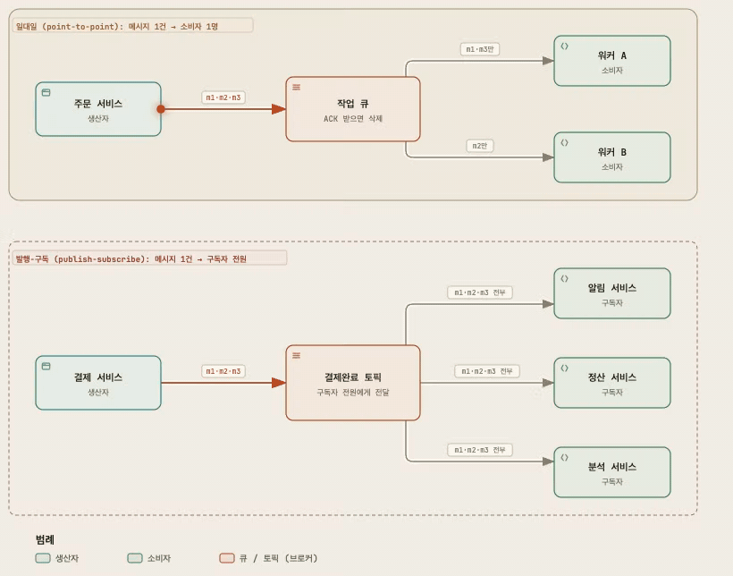

> 시각자료: [메시지 모델: 일대일 vs 발행-구독](assets/ch4-distributed-message-queue/message-models.html)

### 토픽, 파티션, 브로커

- **토픽(topic)**: 메시지를 분류하는 논리적인 이름이다(예: `orders`). 실제 데이터는 토픽에 속한 파티션들에 나뉘어 저장된다.
- **파티션(partition)**: 토픽 하나에 데이터가 너무 많으면 토픽을 여러 파티션으로 나눠(샤딩) 서버에 분산한다. 파티션은 덧붙이기만 하는 로그이자 실제 저장 단위다.
- **브로커(broker)**: 파티션(의 사본)을 보관하는 서버. 파티션을 브로커에 고르게 나누는 것이 규모 확장성의 핵심이다.
  - 예: 파티션 3개를 사본 3개씩 두면 브로커 3대가 각자 사본 3개를 갖고, 파티션마다 리더 사본을 서로 다른 브로커에 두어 부하를 나눈다.
- 각 파티션은 **FIFO 큐**처럼 동작하므로 **파티션 안에서는 순서가 보장된다**. 메시지의 위치는 **오프셋(offset)** 으로 나타낸다.
- 메시지에 **키(key)** 가 있으면 같은 키를 가진 메시지는 같은 파티션으로 간다(예: `hash(key) % 파티션 수`). 키가 없으면 무작위로 정한다.
  - 같은 키의 이벤트끼리는 순서가 유지된다. 단, 파티션 수가 바뀌면 `hash(key) % N` 결과도 바뀐다.
- 확장성을 위해 소비자는 파티션 단위로 메시지를 가져간다.

#### 세 개념의 관계

| 개념 | 정체 | 비유 (DB 샤딩) |
|---|---|---|
| 토픽 | 메시지를 분류하는 **논리적인 이름**. 그 자체로 저장 공간은 없다 | 테이블 이름 |
| 파티션 | 토픽 데이터를 **쪼갠 조각**. 각 조각이 디스크 위의 실제 로그 파일(세그먼트들)로 존재한다 | 샤드 |
| 브로커 | 파티션을 저장하고 요청을 처리하는 **서버(프로세스) 한 대** | DB 서버 노드 |

- 파티션은 논리와 물리가 만나는 지점이다. "토픽을 나눈다"는 면에서는 논리적 단위이고, "어느 브로커의 디스크에 로그 파일로 있다"는 면에서는 물리적 저장 단위다.
- 브로커는 나누는 대상이 아니라 늘리는 대상이다. 서버를 더 붙이면(브로커 추가) 파티션들을 그 위에 다시 나눠 놓는다.
- 개수 관계
  - 토픽 1개 → 파티션 여러 개
  - 파티션 1개 → 사본 여러 개(복제 계수만큼). 각 사본은 서로 다른 브로커에 있고 그중 하나가 리더다.
  - 브로커 1대 → 여러 토픽의 여러 파티션 사본을 함께 보관한다.
  - 파티션 수와 브로커 수는 따로 정한다. 예: 파티션 6개를 브로커 3대에 두면 브로커마다 리더 2개씩을 맡는다.

#### 1브로커 N파티션 vs N브로커 M파티션

- **브로커 1대 + 파티션 3개**: 토픽은 3조각으로 나뉘었지만 모두 서버 한 대에 있다. 소비 쪽은 그룹 안에서 3명까지 병렬로 읽을 수 있지만, 쓰기·저장·네트워크 한계는 서버 1대 그대로이고 그 서버가 죽으면 토픽 전체가 멈춘다.
- **브로커 3대 + 파티션 6개**: 파티션을 브로커마다 2개씩 나눠 놓아 쓰기·저장·네트워크 부하가 서버 3대에 나뉜다. 그룹 안에서 6명까지 병렬로 읽을 수 있고, 같은 파티션의 사본을 다른 브로커에 둘 수 있어 한 대가 죽어도 서비스가 이어진다.
- 정리: 파티션만 늘리면 소비 병렬도만 늘고, 브로커까지 늘려야 쓰기·저장도 확장된다.

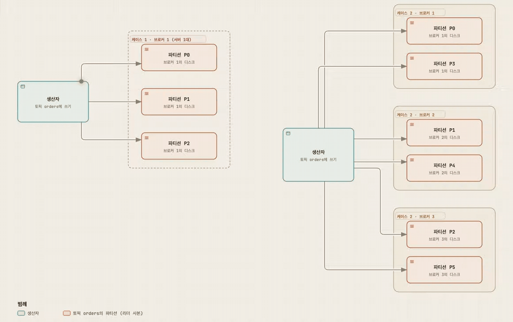

> 시각자료: [브로커와 파티션: 1브로커 N파티션 vs N브로커 M파티션](assets/ch4-distributed-message-queue/broker-partition.html) (팔로워 사본은 생략)

#### 복제까지 포함한 배치

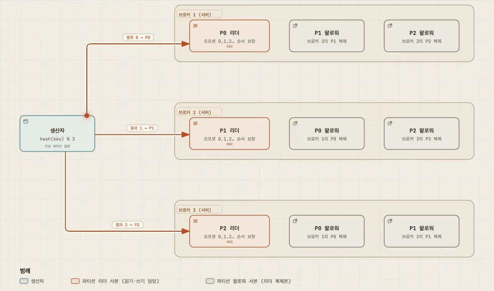

> 시각자료: [토픽 · 파티션 · 브로커 (사본 배치)](assets/ch4-distributed-message-queue/topic-partition-broker.html)

### 소비자 그룹(consumer group)

- 함께 일하는 소비자의 묶음. 그룹마다 서로 다른 토픽을 구독하고 오프셋을 독립적으로 관리한다(예: 과금용 그룹과 회계용 그룹).
- **같은 그룹 안에서는 한 파티션을 한 소비자만 읽는다.** 여러 소비자가 같은 파티션을 읽으면 순서가 깨지기 때문이다.
  - 그래서 같은 그룹의 소비자 A가 맡은 파티션의 이벤트를 같은 그룹의 소비자 B는 읽지 않는다(작업 분담).
  - 그룹 안의 소비자 수가 파티션 수보다 많으면 일부 소비자는 놀게 된다.
  - 모든 소비자를 한 그룹에 넣으면 일대일 모델처럼 동작한다.
- **다른 그룹끼리는 같은 이벤트를 각자 다 읽는다.** 오프셋을 그룹별로 따로 저장하므로 그룹마다 토픽 전체를 독립적으로 읽는다(발행-구독).
- **소비 순서**: 파티션 안에서는 오프셋 순서대로 보장된다. 소비자 한 명이 파티션 여러 개를 맡아도 파티션 사이의 순서는 보장되지 않는다. 순서가 필요한 이벤트는 같은 키로 보내 같은 파티션에 모은다.
- **그룹을 나누는 이유**: 용도(과금·회계 등)마다 처리 속도, 장애, 재처리를 서로 영향 없이 관리하기 위해서다.
- 재조정으로 배정이 바뀌면 새 소비자가 그 파티션의 마지막 커밋 오프셋부터 이어 읽는다. 그래서 커밋 전에 처리한 메시지는 다시 처리될 수 있다.

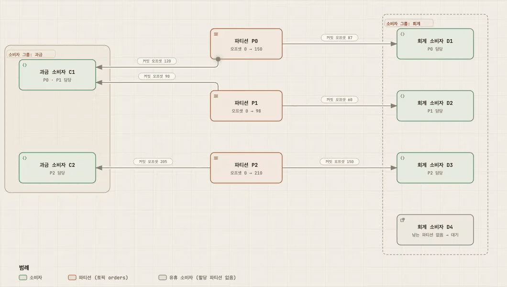

> 시각자료: [소비자 그룹: 같은 토픽을 두 그룹이 각자 읽기](assets/ch4-distributed-message-queue/consumer-groups.html)

### 개략적 아키텍처

- **클라이언트**: 생산자, 소비자 그룹
- **핵심 서비스 및 저장소**
  - 브로커: 파티션을 보관한다.
  - 데이터 저장소: 메시지를 보관한다.
  - 상태 저장소: 소비자 상태(오프셋 등)를 보관한다.
  - 메타데이터 저장소: 토픽 설정과 속성을 보관한다.
- **조정 서비스(coordination service)**: 브로커들이 공유해야 하는 "누가 살아 있고, 누가 책임자인가"를 일관되게 보관하는 별도 저장소. 주로 Apache ZooKeeper나 etcd를 쓴다.
  - **서비스 탐색(service discovery)**: 살아 있는 브로커를 찾는다. 브로커는 기동할 때 ZooKeeper에 임시 노드(`/brokers/ids/번호`)를 만든다. 세션(하트비트)이 끊기면 이 노드가 자동으로 지워지므로, 노드 목록이 곧 살아 있는 브로커 목록이다.
  - **리더 선출(leader election)**: 브로커 중 하나를 컨트롤러로 선출한다. 브로커들이 `/controller` 노드를 먼저 만들려고 경쟁하고, 성공한 하나가 컨트롤러가 된다. 나머지는 그 노드를 감시(watch)하다가 컨트롤러가 죽으면 다시 경쟁한다.
  - 컨트롤러는 파티션 배치를 책임진다. 파티션별 리더를 정해 메타데이터 저장소에 기록하고 브로커들에게 알린다. 브로커가 죽으면 그 브로커가 리더였던 파티션의 새 리더를 ISR 중에서 고른다.
  - 참고: 최신 Kafka(KRaft 모드)는 ZooKeeper 없이 컨트롤러 브로커들이 이 역할을 직접 맡는다.

이 장에는 '리더'라는 말이 네 가지 의미로 쓰여 헷갈리기 쉽다.

| 이름 | 개수 | 역할 |
|---|---|---|
| 컨트롤러 브로커 | 클러스터에 1개 | 조정 서비스로 선출되어 파티션 배치를 정한다 |
| 파티션 리더 사본 | 파티션마다 1개 | 그 파티션의 쓰기·읽기를 받는다 |
| 그룹 코디네이터 | 소비자 그룹마다 담당 브로커 1개 | 그룹 구성원을 관리하고 재조정을 진행한다 |
| 리더 소비자 | 그룹 안 소비자 중 1명 | 파티션 배치 계획을 만들어 코디네이터에 보고한다 |

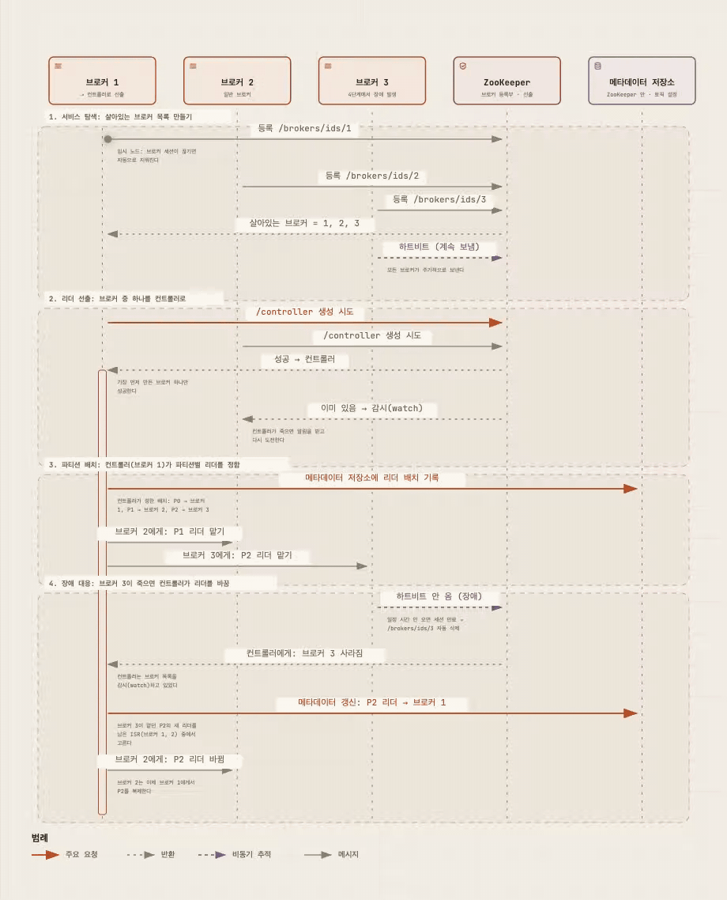

> 시각자료: [조정 서비스 (ZooKeeper): 서비스 탐색과 컨트롤러 선출](assets/ch4-distributed-message-queue/coordination-service.html)

**핵심:** 토픽을 파티션으로 쪼개 브로커에 분산하고, "그룹 안에서 파티션당 소비자 하나" 규칙으로 순서와 확장성을 동시에 얻는다.

---

## 3단계: 상세 설계

데이터 양이 많을 때 높은 대역폭을 달성하기 위한 세 가지 설계 선택:

1. 회전식 디스크의 높은 **순차 탐색 성능**과 운영체제의 **디스크 캐시(페이지 캐시)** 를 적극 활용하는 디스크 기반 자료 구조를 쓴다.
2. 생산자에서 소비자까지 **메시지 자료 구조를 바꾸지 않는다.** 대량 데이터에서는 복사 비용이 크기 때문이다.
3. **일괄 처리(batching)** 를 우선하는 시스템을 설계한다. 생산자, 브로커, 소비자 모두 묶어서 처리한다.

#### 왜 순차 디스크 접근 + OS 페이지 캐시인가

- 회전식 디스크가 느린 이유는 헤드를 옮기고 원판이 돌아오기를 기다리는 시간(탐색) 때문이다. 순차 접근은 이 시간이 거의 없어 빠르다.
- WAL은 쓰기가 전부 파일 끝 덧붙이기이고 읽기도 오프셋 순서라서 I/O 대부분이 순차 접근이 된다.
- 페이지 캐시는 OS가 남는 메모리를 디스크 캐시로 쓰는 것이다. 브로커가 쓴 데이터는 먼저 메모리에 들어가고, 실제 디스크 기록은 OS가 모아서 순차로 한다. 방금 쓴 메시지를 읽는 소비자는 디스크를 거치지 않고, 순차 읽기는 OS가 다음 블록을 미리 읽어 둔다.
- 브로커 안에 캐시를 따로 두는 방식과의 차이(Kafka 설계 문서 기준 참고): 브로커 프로세스를 재시작해도 캐시가 OS에 남는다. JVM 힙에 캐시를 두면 GC 부담이 생기고 같은 데이터를 두 번 보관하게 된다.

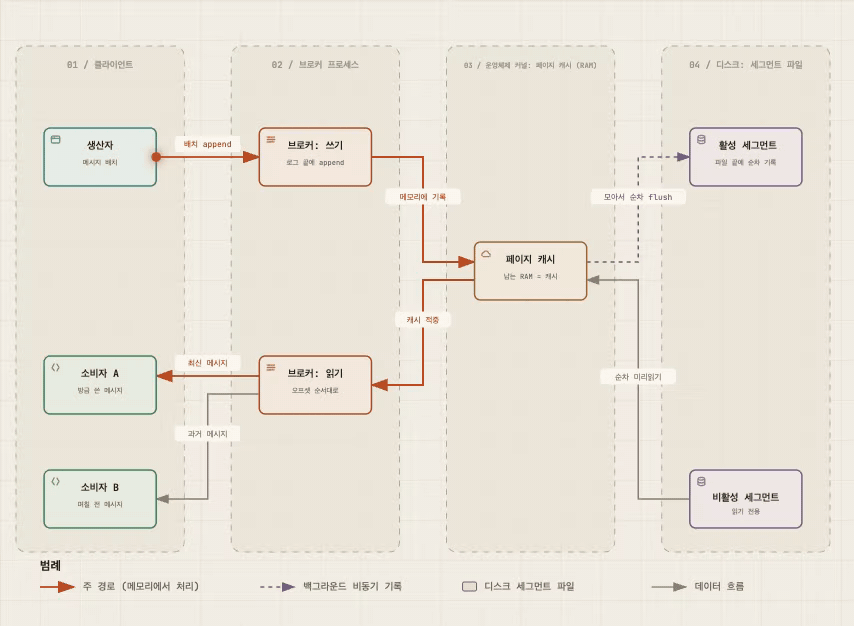

> 시각자료: [순차 디스크 I/O + OS 페이지 캐시: 브로커가 빠른 이유](assets/ch4-distributed-message-queue/page-cache.html)

### 데이터 저장소

**트래픽 패턴 (요구사항)**

- 읽기와 쓰기가 모두 빈번하다.
- 갱신과 삭제는 없다(보관 기간이 지나면 통째로 지운다).
- 대부분 순차 읽기와 순차 쓰기다.

**선택지 1: 데이터베이스** — 관계형이든 NoSQL이든 읽기와 쓰기가 모두 대규모로 몰리는 패턴을 잘 감당하지 못하고, 병목이 되기 쉽다.

**선택지 2: 쓰기 우선 로그(WAL, Write-Ahead Log)** — 새 항목을 덧붙이기만(append-only) 하는 평범한 파일. 이 방식을 채택한다.

- 메시지는 파티션 꼬리에 순차적으로 추가되고, 오프셋은 단조 증가한다.
- 파일 하나가 무한정 커질 수 없으므로 **세그먼트(segment)** 로 나눈다.
  - 새 메시지는 활성 세그먼트에만 추가된다.
  - 활성 세그먼트가 일정 크기에 도달하면 새 활성 세그먼트를 만들고, 기존 세그먼트는 비활성이 되어 읽기만 처리한다.
  - 오래된 비활성 세그먼트는 보관 기간이나 용량 한도를 넘으면 삭제한다.
- 같은 파티션의 세그먼트 파일은 `Partition-{파티션 ID}` 폴더에 모아 둔다.
- **디스크 성능**: 회전식 디스크는 무작위 접근이 느릴 뿐, 순차 접근은 매우 빠르다. RAID로 구성하면 초당 수백 MB를 읽고 쓸 수 있다. 접근 패턴이 순차적이므로 회전식 디스크로도 충분하다.

### 메시지 자료 구조 (예시)

생산자, 큐, 소비자 사이의 계약이다. 전송 중 불필요한 복사를 없애 대역폭을 높이는 데 핵심 역할을 한다.

| 필드 | 설명 |
|---|---|
| key | 파티션을 정하는 데 쓰인다. 키가 없으면 파티션은 무작위로 정한다 |
| value | 메시지 본문(payload). 일반 텍스트일 수도, 압축된 이진 블록일 수도 있다 |
| topic | 메시지가 속한 토픽 이름 |
| partition | 메시지가 속한 파티션 ID |
| offset | 파티션 안에서 메시지의 위치. 토픽 + 파티션 + 오프셋으로 메시지를 특정한다 |
| timestamp | 메시지가 저장된 시각 |
| size | 메시지 크기 |
| crc | 순환 중복 검사(CRC). 원본 데이터의 무결성을 보장한다 |

- 키는 파티션 번호와 다르다. 파티션 수가 바뀌어도 키 기반 매핑 로직은 유지할 수 있다.
- 선택적 기능(예: 태그 기반 필터링)을 위해 필드를 더 추가할 수 있다.

### 일괄 처리(batching)

- 여러 메시지를 한 번의 네트워크 요청으로 보내 왕복 비용을 줄인다.
- 브로커는 메시지를 큰 덩어리로 로그에 기록해, 운영체제 디스크 캐시에 더 큰 연속 블록이 쌓이고 순차 접근 효율이 높아진다.

#### 대역폭과 지연

- **대역폭(처리량)**: 단위 시간에 처리하는 데이터 양이다. 예: 초당 MB, 초당 메시지 수.
- **지연**: 메시지 하나를 보낸 뒤 저장되어 소비할 수 있게 될 때까지 걸리는 시간이다.
- 요청 하나에는 메시지 양과 상관없는 고정 비용(네트워크 왕복, 요청 헤더, 디스크 쓰기 호출)이 든다. 메시지를 묶으면 이 고정 비용을 여러 메시지가 나눠 내므로 같은 시간에 더 많이 보낼 수 있다(대역폭 증가).
- 대신 묶음이 찰 때까지 먼저 온 메시지는 버퍼에서 기다린다(지연 증가).
  - 설명용 예시 값: 왕복 8ms, 메시지가 2ms마다 1건이면 5건을 하나씩 보낼 때 42ms, 묶어 보낼 때 18ms가 걸린다. 그런데 첫 메시지만 보면 혼자 보낼 때 8.4ms, 묶음에서는 18ms다.

#### 대역폭과 응답 지연의 트레이드오프

- 일괄 처리 크기가 크면 대역폭은 높아지지만 지연도 커진다.
- 지연이 중요하면 작은 묶음을 쓰고, 그래도 부족하면 전통적 메시지 큐를 고려한다.
- 대역폭을 높이려면 토픽당 파티션 수를 늘린다. 여러 파티션(브로커)에 병렬로 순차 쓰기를 하므로 전체 대역폭이 늘어난다.
- Kafka 설정 예(참고): `batch.size`(묶음 최대 크기), `linger.ms`(묶음을 기다리는 최대 시간).

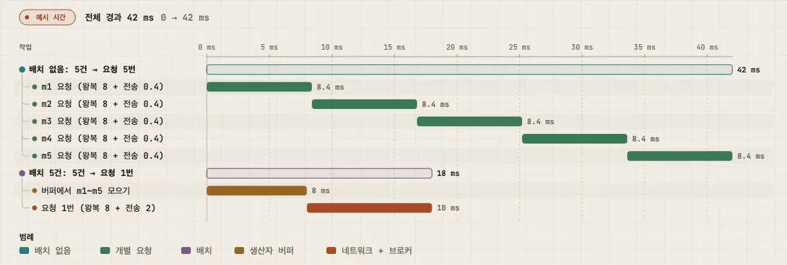

> 시각자료: [일괄 처리: 대역폭과 지연의 트레이드오프](assets/ch4-distributed-message-queue/batching-tradeoff.html) (시간 값은 설명용 예시)

### 생산자 측 작업 흐름

- 처음 구상: 생산자 → **라우팅 계층(routing layer)** → 해당 파티션의 **리더 사본**이 있는 브로커.
  1. 라우팅 계층은 메타데이터 저장소에서 사본 분산 계획을 읽어 캐시해 두고, 메시지를 리더 사본으로 보낸다.
  2. 리더가 메시지를 받으면 다른 사본(follower)이 리더에게서 데이터를 가져간다.
  3. "충분한" 수의 사본이 동기화되면 리더가 데이터를 커밋하고(소비 가능 상태) 생산자에게 응답한다.
- 라우팅 계층의 단점: 거치는 네트워크 노드가 늘어 지연이 커지고, 일괄 처리를 고려하지 않았다.
- 개선: **라우팅 계층을 생산자 클라이언트 안에 넣고, 버퍼를 추가한다.**
  - 네트워크 홉이 줄어 지연이 작아진다.
  - 생산자가 파티션 선택 로직을 직접 가질 수 있다.
  - 버퍼에 메시지를 모았다가 한 번에 보내 대역폭이 높아진다. 묶음 크기는 대역폭과 지연의 트레이드오프다.

#### 리더 사본이란

- 사본(replica)은 같은 파티션의 데이터를 여러 브로커에 복제해 둔 복사본이다. 사본이 3개면 그중 1개가 리더, 나머지는 팔로워다.
- 리더 사본은 그 파티션의 쓰기와 읽기를 받는 대표 사본이다. 생산자는 리더가 있는 브로커로만 보내고, 팔로워는 리더에게서 데이터를 가져가 같은 내용을 유지한다.
- 리더는 브로커 단위가 아니라 파티션 단위다. 예: 브로커 1은 P0의 리더이면서 동시에 P1·P2의 팔로워일 수 있다.
- 쓰기 흐름(`acks=all`): 생산자 → 리더 로그에 추가 → 팔로워들이 fetch로 가져감 → 모든 ISR이 받으면 합의 오프셋 전진 → 생산자에게 ACK → 이때부터 소비자가 읽을 수 있다.

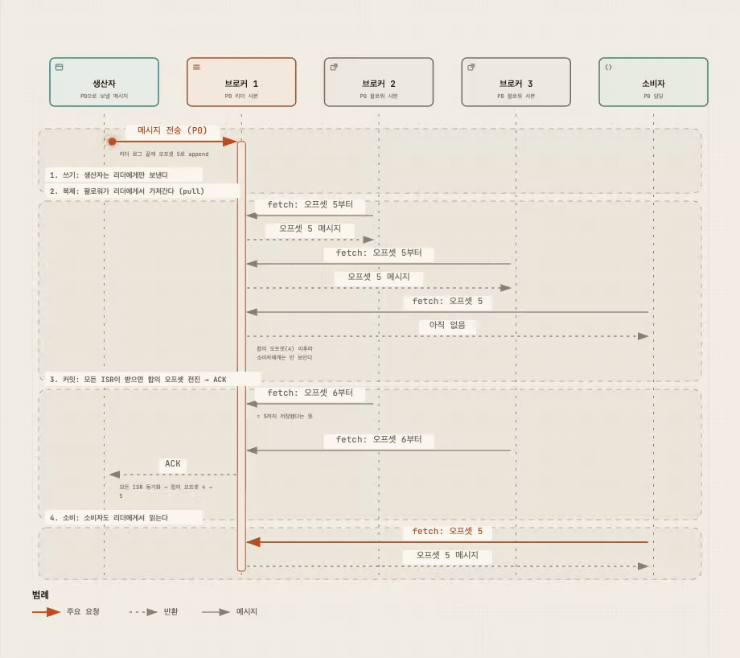

> 시각자료: [리더 사본: 파티션 P0에 메시지 한 건이 쓰이는 과정](assets/ch4-distributed-message-queue/leader-replica.html)

### 소비자 측 작업 흐름

소비자는 파티션의 특정 오프셋을 지정하고 그 위치부터 메시지를 묶어서 가져온다.

| 구분 | 푸시(push) 모델 | 풀(pull) 모델 |
|---|---|---|
| 동작 | 브로커가 소비자에게 메시지를 밀어 넣는다 | 소비자가 브로커에서 메시지를 끌어온다 |
| 장점 | 지연이 낮다. 메시지를 받는 즉시 전달한다 | 소비 속도를 소비자가 정한다. 실시간 소비와 일괄 소비를 나눠 운영할 수 있다. 소비가 생산을 못 따라가면 소비자를 늘리면 된다. 일괄 처리에 유리하다 |
| 단점 | 소비가 생산보다 느리면 소비자가 과부하에 빠진다. 소비자마다 처리 능력이 달라 대응하기 어렵다 | 메시지가 없어도 계속 가져가려 해 자원이 낭비된다. **롱 폴링(long polling)** 으로 완화한다 |

- 대부분의 메시지 큐는 **풀 모델**을 택한다.
- 소비 흐름:
  1. 새 소비자가 그룹에 합류하려 하면, 그룹 이름을 해시해 그 그룹을 담당할 **코디네이터 브로커**를 찾는다. 같은 그룹의 소비자는 모두 같은 코디네이터에 연결한다.
  2. 코디네이터가 소비자를 그룹에 넣고 파티션을 할당한다(라운드 로빈, 범위 기반 등).
  3. 소비자는 상태 저장소에서 마지막으로 소비한 오프셋을 받아 그 위치부터 메시지를 가져온다.
  4. 처리한 뒤 오프셋을 브로커에 커밋한다. 처리와 커밋의 순서가 전달 방식을 결정한다(아래 "메시지 전달 방식" 참고).

### 소비자 재조정(consumer rebalancing)

- 어떤 소비자가 어떤 파티션을 맡을지 다시 정하는 과정. 소비자가 합류하거나, 떠나거나, 장애가 나거나, 파티션이 조정될 때 일어난다.
- **코디네이터**가 소비자로부터 **박동(heartbeat)** 신호를 받으며 그룹 구성원 목록을 관리한다.
- 목록이 바뀌면 코디네이터가 그룹의 새 **리더 소비자**를 고르고, 리더가 새 파티션 배치 계획을 만들어 코디네이터에게 보고하면, 코디네이터가 그룹의 모든 소비자에게 알린다.
- 시나리오:
  - **새 소비자 합류**: 다른 소비자들에게 재조정을 알리고, 모두 다시 합류한 뒤 새 배치 계획을 받는다.
  - **소비자의 정상 퇴장**: 퇴장 요청을 받으면 재조정을 시작한다.
  - **소비자 장애**: 일정 시간 박동이 오지 않으면 장애로 간주하고 재조정을 시작한다.

### 상태 저장소

- 저장 대상: 소비자와 파티션 사이의 대응 관계, 소비자 그룹이 파티션별로 마지막으로 소비한 오프셋.
- 접근 패턴: 읽기와 쓰기가 빈번하지만 양은 적다. 갱신은 빈번하고 삭제는 드물다. 무작위 읽기와 쓰기다. **데이터 일관성이 중요하다.**
- 따라서 ZooKeeper 같은 키-값 저장소가 적합하다. (참고로 Kafka는 오프셋 저장 위치를 ZooKeeper에서 Kafka 브로커 내부로 옮겼다.)

#### 오프셋 저장 위치의 변화와 되감기 (Kafka 공식 문서 기준)

- **과거**: 구 컨슈머는 오프셋을 ZooKeeper의 `/consumers/[그룹]/offsets/[토픽]/[broker_id-partition_id]` 노드에 저장했다(0.8.2 문서의 `offsets.storage=zookeeper`).
  - 그때도 되감기는 가능했다. 그룹 소비자를 모두 멈춘 뒤 해당 노드 값을 원하는 오프셋으로 바꾸고 재시작하는 방식이다. 다만 노드를 직접 고치는 운영 작업이었고, 커밋이 잦으면 ZooKeeper 쓰기 부하가 커지는 점이 Kafka 내부 저장으로 옮긴 이유로 흔히 꼽힌다.
- **전환**: 0.8.2에서 오프셋을 브로커(오프셋 관리자)에 커밋하고 `__consumer_offsets`라는 압축 토픽에 저장하는 방식이 도입됐다. 문서는 ZooKeeper 저장이 향후 폐기될 예정이라며 이전을 권장했다(`offsets.storage=kafka`, `dual.commit.enabled=true`로 롤링 재시작한 뒤 `dual.commit.enabled=false`).
- **현재**: Kafka에서도 되감기가 가능하다.
  - CLI: `kafka-consumer-groups.sh --reset-offsets`. `--to-offset`, `--shift-by`(음수 가능), `--to-earliest`, `--to-latest`, `--to-datetime`, `--by-duration` 등을 지원한다. 기본은 미리보기이고 `--execute`를 붙여야 적용된다. 실행 전에 그 그룹의 소비자가 꺼져 있어야 한다.
  - 코드: `KafkaConsumer.seek(파티션, 오프셋)`으로 실행 중에 읽을 위치를 옮길 수 있다.
- **주의**: 커밋된 오프셋은 "다음에 읽을 위치"다. 10에서 2로 바꾸면 3부터가 아니라 2, 3, 4, … 9를 다시 소비한다. 다시 처리되는 메시지에 대비해 소비자를 멱등하게 만들어야 하고, 되감을 메시지가 보관 기간 안에 남아 있어야 한다(범위를 벗어나면 남아 있는 끝으로 조정된다).

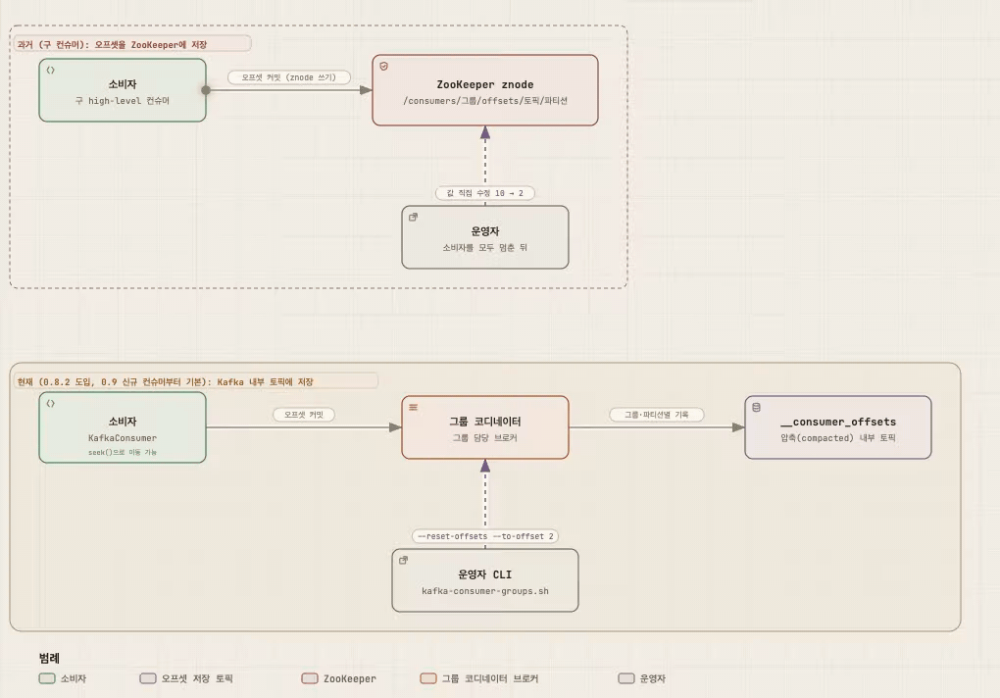

> 시각자료: [소비자 오프셋 저장 위치의 변화와 오프셋 되감기](assets/ch4-distributed-message-queue/offset-storage.html)

### 메타데이터 저장소

- 토픽 설정과 속성을 보관한다: 파티션 수, 메시지 보관 기간, 사본 배치 정보 등.
- 자주 바뀌지 않고 양이 적지만 **높은 일관성**이 필요하다. ZooKeeper가 적합하다.

### 주키퍼(ZooKeeper)

- 계층적 키-값 저장소를 제공하는 분산 설정 서비스. 이 설계에서는 다음을 맡긴다.
  - 메타데이터 저장소와 상태 저장소
  - 브로커 리더 선출(컨트롤러 선출)과 서비스 탐색
- 결과적으로 **브로커는 메시지 데이터 저장소만 유지**하면 되어 설계가 단순해진다.

### 복제(replication)

- 디스크 장애나 브로커 장애로 데이터가 사라지는 것을 막기 위해 파티션을 여러 브로커에 복제한다.
- 파티션마다 **리더 사본** 하나와 여러 **사본(follower)** 이 있다.
  - 생산자는 **리더에게만** 메시지를 보낸다.
  - 사본은 리더에게서 메시지를 계속 가져와 동기화한다.
  - 충분한 수의 사본이 동기화되면 리더가 생산자에게 확인(ACK)을 보낸다.
- **사본 분산 계획**: 조정 서비스로 브로커 중 하나를 리더(컨트롤러)로 선출하고, 그 브로커가 계획을 만들어 메타데이터 저장소에 저장한다.
- 서버 구성 예: 브로커 3대, 토픽 하나에 파티션 3개, 사본 3개라면 브로커마다 사본 3개(리더 1개 + 팔로워 2개)를 갖는다.
  - 같은 파티션의 사본은 서로 다른 브로커에 둔다. 브로커 한 대가 죽어도 다른 브로커의 사본이 남는다.
  - 파티션 리더를 브로커마다 하나씩 나눠 맡겨 쓰기·읽기 부하가 한 브로커에 몰리지 않게 한다.

> 시각자료: [토픽 · 파티션 · 브로커 (사본 배치)](assets/ch4-distributed-message-queue/topic-partition-broker.html), [리더 사본: 파티션 P0에 메시지 한 건이 쓰이는 과정](assets/ch4-distributed-message-queue/leader-replica.html)

### 동기화 사본(ISR, In-Sync Replicas)

- 리더와 동기화된 사본의 집합. 리더 자신은 항상 포함된다.
- "동기화되었다"의 기준은 설정에 따른다. 예를 들어 리더보다 일정 수 이상 메시지가 뒤처지면 ISR에서 빠진다(책은 `replica.lag.max.messages` 같은 설정을 예로 든다. 최신 Kafka에서는 메시지 수가 아니라 시간 기준인 `replica.lag.time.max.ms`를 쓴다).
- **합의 오프셋(committed offset)**: 그 이전의 메시지는 모든 ISR에 이미 동기화되었다는 기준점이다.
- ISR은 성능과 영속성 사이의 트레이드오프를 보여 준다. 생산자가 메시지를 잃지 않으려면 모든 사본이 동기화되어야 안전하지만, 느린 사본 하나가 파티션 전체를 느리게 만들 수 있다.

#### 리더는 분배자가 아니라 "순서를 정하는 단일 지점"

- 리더는 메시지를 받아 팔로워에게 나눠 주지 않는다. 그 파티션의 쓰기를 받아 순서(오프셋)를 정하고, 팔로워가 리더에게 와서 같은 순서대로 가져간다(pull).
- 한 파티션의 트래픽은 그 리더에게 몰린다. 하지만 리더는 파티션마다 있고 브로커마다 서로 다른 파티션의 리더를 맡으므로, 클러스터 전체로는 부하가 나뉜다. 한 파티션이 감당하지 못하면 파티션 수를 늘려 리더를 늘린다.
- 리더가 필요한 이유: 리더 없이 사본마다 쓰기를 받으면 네트워크 지연 때문에 사본마다 저장 순서가 달라질 수 있다. "파티션 안 순서 보장"과 "어디까지 안전하게 복제됐는가(합의 오프셋)"를 지키려면 순서를 정하는 지점이 하나여야 한다.
- 대가: 리더가 있는 브로커가 죽으면 새 리더가 정해질 때까지 그 파티션의 쓰기가 잠시 멈춘다. 리더 없는 복제(Cassandra 등)도 있지만, 순서 보장 대신 충돌 해결이 필요하다.

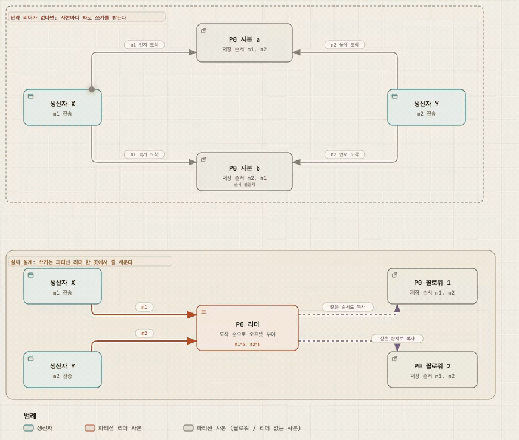

> 시각자료: [리더는 왜 필요한가: 리더 없이 쓰기 vs 파티션별 리더](assets/ch4-distributed-message-queue/why-leader.html)

#### ACK 설정

| ACK 설정 | 동작 | 영속성 | 지연 |
|---|---|---|---|
| ACK=all | 모든 ISR이 메시지를 받은 뒤 ACK | 가장 높음 | 가장 느린 ISR을 기다려야 해서 가장 큼 |
| ACK=1 | 리더가 메시지를 디스크에 저장하면 바로 ACK | 중간. ACK 직후 데이터가 복제되기 전에 리더가 죽으면 메시지가 사라진다 | 중간 |
| ACK=0 | ACK를 기다리지 않고 계속 전송, 재시도 없음 | 가장 낮음. 메시지가 사라질 수 있다 | 가장 작음 |

- 이 설정으로 대역폭(지연)과 영속성을 원하는 수준에 맞출 수 있다. 예를 들어 지표 수집이나 로깅처럼 데이터가 일부 유실되어도 되는 경우는 ACK=0이 적합하다.
- **소비자는 리더에게서 읽는다.** ISR에서 읽지 않는 이유:
  - 설계와 운영이 단순하다.
  - 한 파티션의 메시지는 그룹 안의 한 소비자만 읽으므로 리더에 붙는 연결 수가 많지 않다.
  - 아주 인기 있는 토픽이 아니라면 리더 연결 수는 크지 않다. 인기 있는 토픽은 파티션과 소비자를 늘려 확장한다.
  - 예외: 소비자가 리더와 다른 데이터센터에 있으면 가장 가까운 ISR에서 읽는 편이 낫다.
- ISR 여부는 리더가 각 사본이 얼마나 뒤처졌는지 추적해 판단한다.

### 규모 확장성

- **생산자**: 그룹 단위 조정이 필요 없으므로 인스턴스를 더하거나 빼기만 하면 된다.
- **소비자**: 소비자 그룹은 서로 격리되어 있어 그룹을 쉽게 추가하거나 제거할 수 있다. 그룹 안의 소비자 증감과 장애는 재조정 메커니즘이 처리한다.
- **브로커(장애 복구)**:
  - 브로커가 죽으면 그 브로커에 있던 파티션의 사본이 줄어든다. 컨트롤러가 사라진 사본을 다른 브로커에 다시 만들고, 새 사본이 리더를 따라잡을 때까지 기다린다.
  - 고려 사항:
    - 최소 ISR 수: 몇 개 사본에 기록되어야 성공으로 볼지. 많을수록 안전하지만 지연이 커진다.
    - 같은 파티션의 사본은 같은 브로커에 두지 않는다. 한 노드가 죽으면 모든 사본이 사라지기 때문이다.
    - 한 파티션의 사본이 모두 죽으면 그 파티션 데이터는 영원히 사라진다. 사본 수와 위치를 정할 때 데이터 안전성과 비용을 함께 따진다. 다른 데이터센터에 사본을 두면 안전하지만 지연과 비용이 늘어난다(데이터센터 간 미러링으로 해결하기도 한다).
  - 브로커를 추가할 때는 사본을 새 브로커로 옮기는 동안 **일시적으로 설정보다 많은 사본을 허용**하고, 새 사본이 따라잡으면 남는 사본을 지운다.
- **파티션**:
  - **파티션 추가**: 기존 데이터는 그대로 두고, 새 메시지만 새 파티션을 포함한 전체 파티션에 저장된다. 소비자는 재조정을 거친다.
  - **파티션 삭제**: 해당 파티션을 퇴역시키고 새 메시지는 남은 파티션으로 보낸다. 퇴역한 파티션 데이터는 소비자가 아직 읽고 있을 수 있으므로 **보관 기간이 지난 뒤에** 삭제한다. 그때까지는 저장 공간이 바로 확보되지 않는다.

#### 예시: 쇼핑몰 주문 이벤트로 보는 상황별 확장

구성: 주문 API 서버(생산자) → 토픽 `orders`(파티션 6개, 브로커 3대) → 결제·알림 소비자 그룹

| 상황 | 대응 |
|---|---|
| 주문 폭주(할인 행사) | 생산자인 API 서버끼리는 조정할 필요가 없으므로 인스턴스만 늘린다 |
| 결제 처리가 밀림 | 결제 그룹에 소비자를 추가하면 재조정으로 파티션을 다시 나눈다. 상한은 파티션 수(6개)이고, 넘는 소비자는 논다 |
| 새 용도(실시간 분석) 추가 | 새 소비자 그룹을 만든다. 기존 그룹과 생산자는 그대로이고, 오프셋을 따로 가지므로 보관 기간 안의 과거 이벤트부터 읽을 수도 있다 |
| 브로커 디스크·부하 한계 | 브로커를 추가하고 사본 일부를 새 브로커로 옮긴다. 옮기는 동안은 사본이 설정보다 많아지고, 새 사본이 따라잡으면 기존 사본을 지운다 |
| 파티션 부족 | 파티션을 추가한다. 기존 데이터는 그대로이고 새 메시지만 늘어난 파티션에 나뉜다. `hash(key) % N`의 N이 바뀌어 같은 키가 다른 파티션으로 갈 수 있으니, 키 순서가 중요하면 주의한다 |

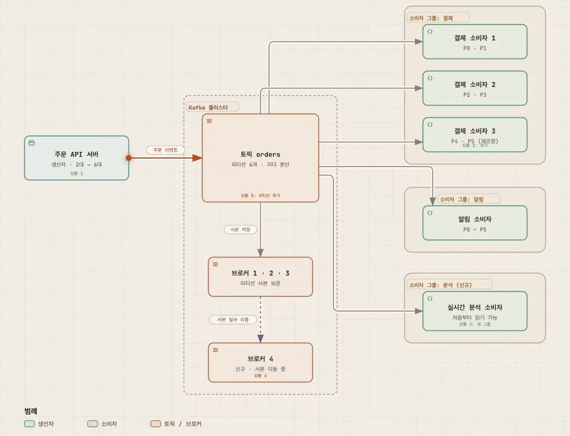

> 시각자료: [규모 확장성: 쇼핑몰 주문 이벤트로 보는 상황별 확장 지점](assets/ch4-distributed-message-queue/scaling-example.html) (설명을 위한 가상 사례)

### 메시지 전달 방식

| 전달 방식 | 생산자 쪽 | 소비자 쪽 | 결과 | 적합한 용도 |
|---|---|---|---|---|
| 최대 한 번(at-most-once) | ACK=0, 재시도 없음 | 메시지를 **처리하기 전에** 오프셋 커밋 | 유실 가능, 중복 없음 | 모니터링 지표처럼 소량 유실을 감수할 수 있는 경우 |
| 최소 한 번(at-least-once) | ACK=1 또는 all, 실패 시 재시도 | 메시지를 **처리한 뒤에** 오프셋 커밋 | 유실 없음, 중복 가능 | 중복을 제거할 수 있는 경우(메시지에 고유 키를 두어 중복 제거) |
| 정확히 한 번(exactly-once) | — | — | 유실도 중복도 없음 | 지불, 매매, 회계처럼 중복도 유실도 허용되지 않는 금융 관련 용도 |

- 정확히 한 번은 사용자 입장에서는 가장 편하지만 시스템 성능과 구현 복잡도의 대가가 크다. 책은 세부 구현을 깊게 다루지 않는다.

### 고급 기능

- **메시지 필터링**
  - 소비자가 특정 유형의 메시지만 원할 때, 유형마다 토픽을 따로 만드는 방법은 같은 데이터를 중복 저장하게 되고 생산자와 소비자의 결합도를 높인다.
  - 그래서 **브로커에서 필터링**한다. 단, 메시지 본문으로 필터링하면 본문을 복호화하거나 역직렬화해야 해 성능이 떨어진다.
  - 메시지 메타데이터에 **태그(tag)** 를 붙이고 태그로 필터링한다. 소비자는 구독할 때 원하는 태그를 지정한다.
- **메시지 지연 전송 및 예약 전송**
  - 예: 주문 후 30분 안에 결제되지 않으면 취소. 메시지를 바로 소비자에게 보내지 않고 브로커 쪽 **임시 저장소**에 두었다가 시간이 되면 토픽으로 옮긴다.
  - 핵심 구성 요소:
    - 임시 저장소: 특별한 메시지 토픽 하나 이상
    - 타이밍 기능: 미리 정한 지연 단계별 전용 큐(RocketMQ는 1초, 5초, 10초, 30초, 1분 같은 고정 단계만 지원), 또는 **계층적 타이밍 휠(hierarchical time wheel)**
  - 예약 전송은 지정한 시각에 메시지를 전달하는 기능이며 설계는 지연 전송과 비슷하다.

**핵심:** WAL과 세그먼트로 순차 I/O를 극대화하고, 일괄 처리로 대역폭을 얻고, 복제와 ISR, ACK 설정으로 영속성과 지연 사이의 균형을 고른다.

---

## 4단계: 마무리

시간이 남으면 추가로 논의할 만한 주제:

- **프로토콜**: 노드 사이에 데이터를 주고받는 규칙. 생산, 소비, 박동 같은 동작을 정의하고, 대용량 데이터를 효율적으로 전송하며, 데이터 무결성과 정확성을 검증할 수 있어야 한다. 예: AMQP, Kafka 프로토콜.
- **소비 재시도**: 처리에 실패한 메시지를 바로 재시도하면 뒤따르는 메시지 처리가 막힌다. 실패한 메시지를 **재시도 전용 토픽**으로 보내 나중에 다시 소비한다.
- **이력 데이터 아카이브**: 시간 기반 또는 용량 기반으로 로그를 보관한다. 이미 삭제된 오래된 메시지를 다시 처리해야 한다면, 오래된 데이터를 **HDFS나 객체 저장소** 같은 대용량 저장소로 옮겨 두는 방법이 있다.

---

## 한눈에 보는 면접 포인트

- 왜 데이터베이스가 아니라 **쓰기 우선 로그(WAL)** 인가: 읽기와 쓰기가 모두 많고, 갱신과 삭제가 없으며, 순차 접근이기 때문이다.
- 왜 **파티션 안에서만** 순서를 보장하는가: 전역 순서는 확장성을 포기해야 얻을 수 있다. 순서가 필요한 메시지는 같은 키로 같은 파티션에 보낸다.
- 왜 **풀 모델**인가: 소비 속도를 소비자가 정하고, 일괄 처리에 유리하다.
- **ACK 설정과 오프셋 커밋 시점**의 조합이 전달 방식을 결정한다.
- 소비자 재조정은 **코디네이터 + 박동 + 리더 소비자의 배치 계획**으로 이루어진다.

---

## 부록: 대역폭(Bandwidth)

### 대역폭이란

- **단위 시간에 옮기거나 처리할 수 있는 데이터 양**이다. 네트워크에서는 bps(초당 비트), 시스템에서는 초당 MB나 초당 메시지 수로 나타낸다.
- 이 장에서 말하는 "대역폭"은 네트워크 회선 속도만이 아니라 **시스템 전체가 초당 처리할 수 있는 양(처리량, throughput)** 에 가깝다.
- 수도관에 비유하면 대역폭은 **관의 굵기**(한 번에 얼마나 많이 흐르나), 지연은 **물이 끝까지 도착하는 데 걸리는 시간**(하나가 얼마나 빨리 도착하나)이다.
  - 두 값은 서로 다른 축이다. 관이 굵어도 길면 늦게 도착하고, 관이 가늘어도 짧으면 빨리 도착한다.
  - 일괄 처리처럼 대역폭을 키우는 방법이 지연을 늘리기도 해서 둘 사이에 트레이드오프가 생긴다([일괄 처리](#일괄-처리batching) 참고).

### 메시지 큐에서 고대역폭이 중요한 이유

**1. 처리량이 유입보다 작으면 밀린 메시지가 끝없이 쌓인다**

- 메시지 큐는 들어오는 속도와 나가는 속도의 차이를 잠시 흡수하는 버퍼다. 하지만 평균 처리량이 평균 유입량보다 작으면 차이만큼 계속 쌓인다.
- 예: 유입 100MB/s, 처리 80MB/s면 매초 20MB, 1시간에 약 72GB가 밀린다. 밀린 양만큼 지연도 계속 늘어나고, 보관 기간이 지나면 읽기도 전에 지워질 수 있다.

**2. 쓰기 1번이 브로커에서 트래픽 여러 번이 된다**

- 사본 3개(리더 포함)에 소비자 그룹 3개라면, 생산자가 쓴 100MB/s는 리더 브로커에서 이렇게 늘어난다.

| 구간 | 트래픽 |
|---|---|
| 생산자 → 리더 (쓰기, 디스크 기록) | 100MB/s |
| 리더 → 팔로워 2개 (복제) | 200MB/s |
| 리더 → 소비자 그룹 3개 (읽기) | 300MB/s |
| **리더 브로커 송신 합계** | **500MB/s (유입의 5배)** |

- 그래서 필요한 대역폭은 "초당 유입량"만 보고 정하면 안 되고, 사본 수와 소비자 그룹 수를 곱해서 따져야 한다.

**3. 가장 좁은 구간이 전체 처리량을 정한다**

- 생산자 네트워크, 브로커 디스크 쓰기, 복제, 소비자 처리 중 하나라도 좁으면 전체 처리량은 그 값으로 묶인다.
- `acks=all`이면 가장 느린 ISR까지 기다리므로, 복제 구간의 대역폭이 곧 쓰기 속도의 상한이 된다.

**4. 따라잡기와 재처리에는 평소보다 큰 여유가 필요하다**

- 소비자 장애 뒤 밀린 메시지를 따라잡거나, 오프셋을 되감아 재처리할 때는 새로 들어오는 양에 더해 밀린 양까지 처리해야 한다.
- 평소 처리량이 유입량과 딱 맞으면 영원히 따라잡지 못한다.

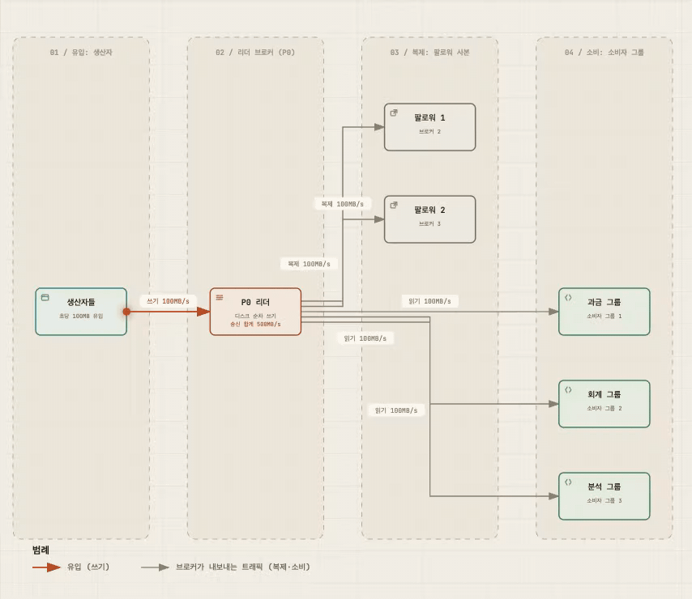

> 시각자료: [대역폭: 쓰기 1번이 브로커에서 트래픽 6번이 된다](assets/ch4-distributed-message-queue/bandwidth.html) (값은 설명용 예시)

### 이 장의 설계가 대역폭을 얻는 방법

| 방법 | 넓히는 구간 |
|---|---|
| 쓰기 우선 로그(WAL) + 순차 디스크 I/O | 디스크 쓰기·읽기 |
| OS 페이지 캐시 활용 | 최근 메시지 읽기 (디스크를 거치지 않음) |
| 메시지 자료 구조를 바꾸지 않음 | 전송 중 복사 비용 |
| 일괄 처리 | 요청당 고정 비용(네트워크 왕복, 헤더, 쓰기 호출) |
| 파티션 수 늘리기 | 리더를 여러 브로커에 흩어 쓰기·송신 부하를 병렬로 나눔 |

---

## 참고자료

- 『가상 면접 사례로 배우는 대규모 시스템 설계 기초 2』 4장 분산 메시지 큐
- [Apache Kafka 0.8.2 Documentation: Distribution](https://kafka.apache.org/082/implementation/distribution/) (ZooKeeper 오프셋 저장 경로, `__consumer_offsets` 이전 절차)
- [Apache Kafka 4.0 Documentation: Basic Kafka Operations](https://kafka.apache.org/40/operations/basic-kafka-operations/) (`--reset-offsets` 옵션)
